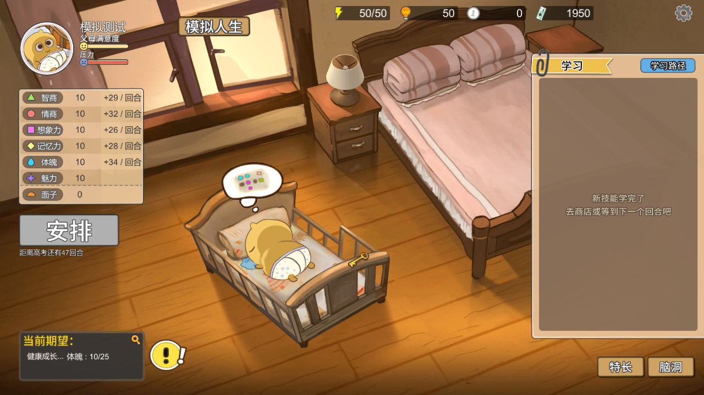
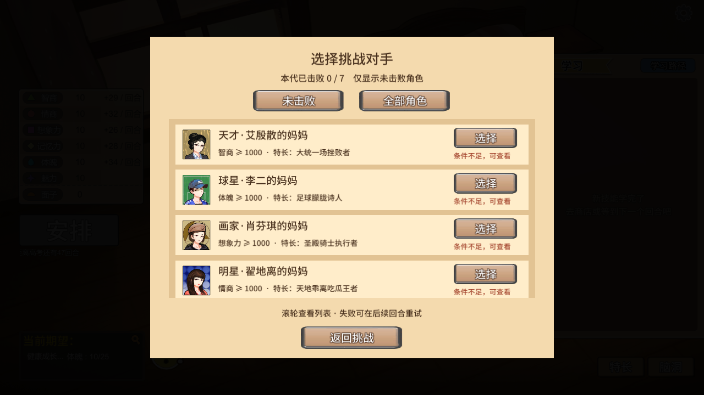
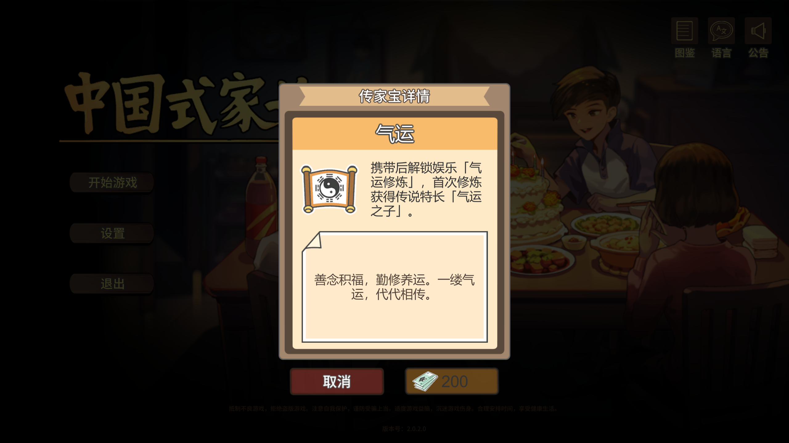
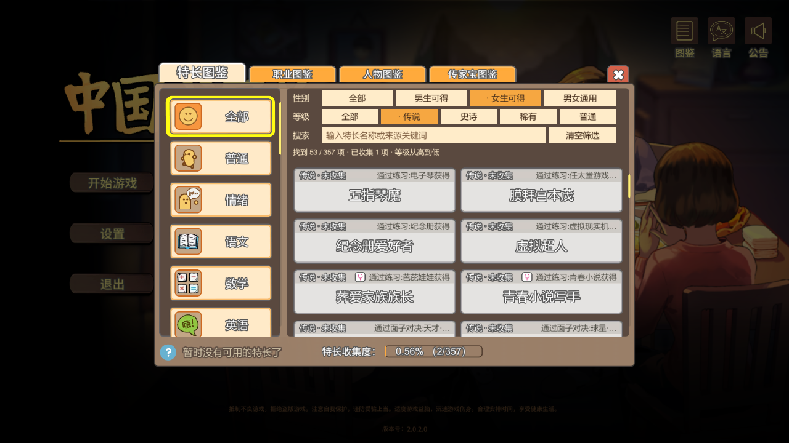

# 中国式家长 · 十合一模组合集

十个功能可独立安装、独立关闭，下载包包含经过验证的运行环境和中文说明。

**[下载最新安装包](https://github.com/InkAutumn/ChineseParents-Mods/releases/latest/download/ChineseParents-Mods-2026.10.12.zip)** · [版本发布页](https://github.com/InkAutumn/ChineseParents-Mods/releases/latest) · [反馈问题](https://github.com/InkAutumn/ChineseParents-Mods/issues)

请下载发布页中名称为 `ChineseParents-Mods-2026.10.12.zip` 的附件。GitHub 自动生成的 `Source code (zip)` 是本仓库的说明材料，不是模组安装包。

## 适用版本

Windows Steam 版《中国式家长》，Steam Build **24710774**（游戏显示版本 **2.0.2.0**），Unity 2022.3.62f3c1 x86 Mono。
其他平台和后续构建尚未验证。包内包含 BepInEx 5.4.23.5 x86 与本构建专用的 MonoMod 兼容修正；无需安装开发工具。

## 功能

| 模组 | 版本 | 功能 |
| --- | --- | --- |
| 安排必得特长 | 1.0.1 | 安排对应特长概率100%，保留年龄、性别和重复获得限制。 |
| 脑洞全图透视 | 1.1.1 | 脑洞全图显示，可直接点击远处有效格子。 |
| 打工快速结算 | 1.0.1 | 打工快速结算，省去动画等待。 |
| 复习可选跳过 | 1.0.1 | 复习可选跳过，确认前显示行动力成本与预计悟性范围。 |
| 社交好感度预测 | 1.0.0 | 社交选项显示预计好感度变化，随机效果显示范围。 |
| 气运传家宝 | 1.0.0 | 新增气运传家宝、气运修炼与传说特长气运之子。 |
| 特长图鉴整理 | 1.0.0 | 图鉴增加全部、性别/等级筛选和名称/来源搜索。 |
| 模拟人生 | 1.0.3 | 预览剩余人生，确认并备份后进入下一代。 |
| 挑战自由选人 | 1.0.0 | 从7位挑战角色中自由选人，已击败者本代不可重复领奖。 |
| 首富之子 | 1.0.0 | 每回合零花钱收入最低80；200仍是200，不把总余额固定为80。 |

## 安装

1. 退出游戏，备份存档，并完整解压安装包。
2. Steam 库中右键游戏 → 管理 → 浏览本地文件，找到包含 `game.exe` 的目录。
3. 双击包内 `Check-Compatibility.cmd`，选择该游戏目录；检查通过后再继续。
4. 把包内“复制到游戏根目录”里面的内容复制到游戏目录，再从 Steam 启动。
5. 首次运行生成独立配置后，退出游戏，将相应 `.cfg` 的 `[General]` 下 `Enabled = true` 改为 `false` 可关闭功能。

只安装部分模组时，保留公共运行环境，仅选择需要的 `BepInEx/plugins` 子文件夹。

完整备份、安装与卸载步骤见 [安装说明](docs/installation.txt)，每个模组的细节见 [模组说明](docs/mods)。

## 使用说明

- **气运传家宝**：存档用过新增内容后请保留该模组 DLL；暂时不用时关闭配置。彻底移除前应恢复使用新增内容之前的整套存档和账号数据。
- **模拟人生**：预览可取消；确认进入下一代后会提交进度，并先备份到 `BepInEx/LifeSimulatorBackups`。快速模拟会省略小游戏、逐条随机剧情领奖和新特长奖励等。
- **首富之子**：调整每回合收入下限，沿用商店开放后的原版发放时机，读档不会额外发钱。
- 关闭模组不会撤销已获得的属性、金钱或已提交的下一代；需要回退时使用此前备份。
- 与第三方模组的组合未逐一验证，请避免同一功能的旧版插件重复加载。

## 界面预览






## 验证与发行内容

各功能已进行隔离验证，以上十个版本已共同通过游戏启动与正常退出检查。本次发布的 DLL 与已验证版本逐文件一致；发行包已进行完整性和解压校验，版本检查工具已验证可拒绝错误构建和损坏文件。

下载包不包含游戏本体、原游戏程序集、玩家存档、账号文件或测试插件。第三方组件的许可证及 Doorstop 对应源码随安装包提供。本仓库用于发布安装包、说明和截图。

本次安装包 SHA-256：

```text
4AA4CC8D7828649A793C8AB82365FBFB583302C9FC3ED82BCCE5AF10077FD09A
```
